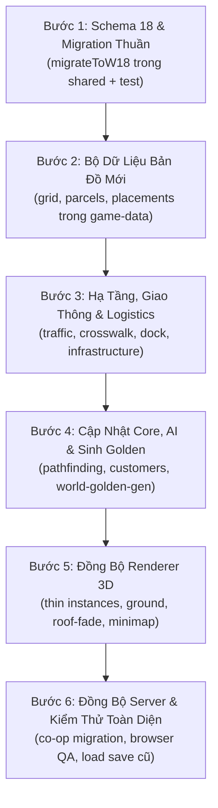

# Đề Xuất Quy Hoạch & Thiết Kế Lại Bản Đồ 3D (Giai Đoạn C5)

> **Mục tiêu tài liệu**: Khảo sát hiện trạng tổ chức bản đồ trong `packages/game-data`, phân tích các ràng buộc phụ thuộc toạ độ (save, co-op, test, logistics, pathfinding), so sánh 2 phương án bố cục bản đồ mới tối ưu cho đồ họa 3D (BabylonJS), và lập kế hoạch triển khai từng bước cho giai đoạn C5 trong [3d-migration-plan.md](file:///c:/Users/Admin/Desktop/SIEU-THI-DATNT/docs/plans/3d-migration-plan.md).  
> **Phạm vi phiên làm việc**: Khảo sát & Đề xuất kiến trúc — **KHÔNG sửa code, KHÔNG commit**.

---

## 1. Hiện Trạng Bản Đồ Trong `packages/game-data`

### 1.1. Các file cấu hình nguồn và trách nhiệm

Bản đồ thế giới hiện tại được tách lớp theo kiến trúc hướng dữ liệu (OpenSpec `open-world-land-grid` & `open-world-land-reclamation`):

| File nguồn | Trách nhiệm chính & Hằng số then chốt |
|---|---|
| [`map.ts`](file:///c:/Users/Admin/Desktop/SIEU-THI-DATNT/packages/game-data/src/map.ts) | Kích thước bản đồ chơi đợt 0: `MAP_WIDTH = 36`, `MAP_HEIGHT = 22`, `MAP_ORIGIN_Y = -6`. Vùng chơi ban đầu: `PLAY_REGION = { x0: 0, x1: 35, y0: -6, y1: 15 }`. Điểm sinh người chơi `ONLINE_SPAWN_POINTS` (vỉa hè cửa tiệm $(9, 11.5)$), vị trí chủ tiệm `SHOPKEEPER_TILE` $(8, 7)$, nội thất khởi tạo `INITIAL_FIXTURES`, `WAREHOUSE_FIXTURES`, logic dựng tile map `generateStarterTileMap`. |
| [`world/world-grid.ts`](file:///c:/Users/Admin/Desktop/SIEU-THI-DATNT/packages/game-data/src/world/world-grid.ts) | Lưới hình học thế giới: `WORLD_BOUNDS = { x0: -42, x1: 77, y0: -36, y1: 43 }` (kích thước tổng thể $120 \times 80$ ô, tương đương $3840 \times 2560\text{ px}$). Hàm hợp vùng chơi theo các đợt mở `playRegionForWaves(openedWaves)`. |
| [`world/waves.ts`](file:///c:/Users/Admin/Desktop/SIEU-THI-DATNT/packages/game-data/src/world/waves.ts) | Định nghĩa 5 đợt khai hoang `RECLAMATION_WAVES` (`w0` đến `w4`), điều kiện cấp mở khóa (`unlockLevel`), chi phí (`cost`), số ngày thi công (`constructionDays = 2`), và danh mục các lô đất (`parcels`) của từng đợt. |
| [`world/parcels.ts`](file:///c:/Users/Admin/Desktop/SIEU-THI-DATNT/packages/game-data/src/world/parcels.ts) | Định nghĩa các lô đất cơ bản `LAND_PARCELS` đợt 0 (`lot-west`, `lot-center`, `lot-east-1`, `lot-east-2`) và các lô đợt mở rộng `WAVE_LAND_PARCELS`. Hệ số định giá vị trí `FRONTAGE_VALUE` (mặt đường chính/phụ, lô góc), hệ số khách `FRONTAGE_TRAFFIC`, giá cơ bản `PARCEL_BASE_PRICE = 12.000₫/ô`. |
| [`world/placements.ts`](file:///c:/Users/Admin/Desktop/SIEU-THI-DATNT/packages/game-data/src/world/placements.ts) | Vị trí đặt mặc định `DEFAULT_PLACEMENTS` của 4 tòa đợt 0: `main` (gốc $(6, 3)$), `xoi` (gốc $(0, 3)$), `snack` (gốc $(21, 3)$), `drink` (gốc $(26, 3)$). Hàm tính toán hình học `placementGeometry` (biên `bounds`, cửa `doorTiles`, hiên `awning`, nội thất theo vị trí tuyệt đối). |
| [`world/infrastructure.ts`](file:///c:/Users/Admin/Desktop/SIEU-THI-DATNT/packages/game-data/src/world/infrastructure.ts) | Hạ tầng cố định đợt 0: Vỉa hè ($y = 11, 12$), mặt đường chính `ROAD_PROFILE` ($y = 13..15$), 3 cột đèn đường `STREET_LAMP_TILES` tại $(9, 12), (15, 12), (21, 12)$, 5 cây xanh `TREE_PROPS` tại các cột $x = 5, 19, 25, 28, 34$, điểm đỗ xe máy vỉa hè `STREET_PARKING_SPOTS`, điểm đỗ ô tô `CAR_PARKING_SPOTS`, rãnh và hố thu nước mưa `STORM_DRAINS`. |
| [`world/civic.ts`](file:///c:/Users/Admin/Desktop/SIEU-THI-DATNT/packages/game-data/src/world/civic.ts) | Công trình công cộng `CIVIC_DEFS`: Công viên (`park` $6\times 6$), Trạm y tế (`clinic` $6\times 8$), Công an phường (`ward_police` $6\times 8$), Trường tiểu học (`primary_school` $8\times 8$). Điểm QoL, bán kính hiệu lực, phí duy trì, phí xóm `OWNED_TILE_FEE`. |
| [`traffic.ts`](file:///c:/Users/Admin/Desktop/SIEU-THI-DATNT/packages/game-data/src/traffic.ts) | Vạch sang đường cho khách đi bộ `STORE_FRONT_CROSSWALK` ($x \in [256, 384]\text{ px}$ tức cột $8..12$, $y \in [416, 512]\text{ px}$ tức hàng $13..16$). Cấu hình chu kỳ đèn tín hiệu 39 giây (`STORE_FRONT_SIGNAL`, `INTERSECTION_SIGNAL`). |
| [`logistics.ts`](file:///c:/Users/Admin/Desktop/SIEU-THI-DATNT/packages/game-data/src/logistics.ts) | Khu vực bốc dỡ hàng hóa `LOADING_DOCK_CONFIG`: ô $x = 17..22$, $y = 11..13$; vị trí dừng xe tải `truckStopPosition` $(688, 422)\text{ px}$, vị trí đuôi xe $(800, 390.4)\text{ px}$, cửa nhập kho `warehouseStagingPosition` $(304, 144)\text{ px}$. |
| [`neighborhood.ts`](file:///c:/Users/Admin/Desktop/SIEU-THI-DATNT/packages/game-data/src/neighborhood.ts) | Mạng lưới giao thông toàn khu: Đường ngang `TRAFFIC_ROADS` (`main` hàng 13, `school` hàng -20, `south` hàng 25), Đường dọc `AVENUES` (`west` cột $-7..-4$, `east` cột $38..41$), các ngã tư đèn đỏ `INTERSECTIONS`, điểm đón khách `SHOP_FRONT`, bốt bảo vệ `SECURITY_POST`. |

---

### 1.2. Kích thước và Tọa độ Chi tiết Đợt 0 và các Đợt Khai hoang

#### Các đợt khai hoang (Reclamation Waves):
- **Đợt 0 (`w0`)**: Toàn bộ khu lõi ban đầu. Vùng chữ nhật $x \in [0, 35], y \in [-6, 15]$ (kích thước $36 \times 22$ ô). Cấp yêu cầu: 1, chi phí: 0₫.
- **Đợt 1 (`w1` - Đông ngã tư)**: $x \in [36, 60], y \in [3, 15]$ ($25 \times 13$ ô). Cấp 20, giá 800.000₫. Gồm 2 lô: `w1-corner` ($x \in [42, 51], y \in [3, 10]$) và `w1-east` ($x \in [52, 60], y \in [3, 10]$).
- **Đợt 2 (`w2` - Nam hẻm)**: $x \in [0, 35], y \in [16, 25]$ ($36 \times 10$ ô). Cấp 30, giá 1.200.000₫. Gồm 4 lô mặt đường phía nam: `w2-1` đến `w2-4` ($y \in [16, 23]$).
- **Đợt 3 (`w3` - Đông xa)**: $x \in [61, 76], y \in [3, 15]$ ($16 \times 13$ ô). Cấp 40, giá 2.000.000₫. Gồm 2 lô: `w3-1`, `w3-2`.
- **Đợt 4 (`w4` - Nam đông)**: $x \in [42, 76], y \in [16, 25]$ ($35 \times 10$ ô). Cấp 50, giá 3.000.000₫. Gồm 4 lô: `w4-corner` đến `w4-4`.

#### Chi tiết 4 Lô đất và 4 Tòa nhà cốt lõi (Đợt 0):
1. **Lô Tây (`lot-west`)**: $x \in [0, 6], y \in [-3, 10]$ (rộng 7, cao 14).
   - Tòa nhà: **Quán Xôi Cô Ba (`xoi_shop`)**, gốc $(0, 3)$, footprint $7 \times 8$ ô ($x \in [0, 6], y \in [3, 10]$). Cửa tại $(4, 10)$, hiên che rộng 7 ô.
2. **Lô Trung tâm (`lot-center`)**: $x \in [6, 21], y \in [-3, 10]$ (rộng 16, cao 14).
   - Tòa nhà: **Tiệm Tạp Hóa Đầu Hẻm (`grocery_main`)**, gốc $(6, 3)$, footprint $15 \times 8$ ô ($x \in [6, 20], y \in [3, 10]$).
     - Phần lõi (core): $10 \times 8$ ($x \in [6, 15]$), cánh đông mở rộng: $5 \times 8$ ($x \in [16, 20]$).
     - Cửa chính: 2 ô tại $(9, 10)$ và $(10, 10)$.
     - **Nhà kho (`warehouse`)**: Gốc $(6, -3)$, kích thước $8 \times 7$ ô ($x \in [6, 13], y \in [-3, 3]$), thông cửa nội bộ với gian hàng tạp hóa tại hàng $y = 3$.
3. **Lô Đông 1 (`lot-east-1`)**: $x \in [21, 26], y \in [-3, 10]$ (rộng 6, cao 14).
   - Tòa nhà: **Quán Ăn Vặt (`snack_shop`)**, gốc $(21, 3)$, footprint $5 \times 8$ ô ($x \in [21, 25], y \in [3, 10]$). Cửa tại $(23, 10)$.
4. **Lô Đông 2 (`lot-east-2`)**: $x \in [26, 35], y \in [-3, 10]$ (rộng 10, cao 14).
   - Tòa nhà: **Quán Nước Vỉa Hè (`drink_shop`)**, gốc $(26, 3)$, footprint $10 \times 8$ ô ($x \in [26, 35], y \in [3, 10]$). Cửa tại $(30, 10)$ và $(31, 10)$.

---

### 1.3. Sơ đồ ASCII Hiện Trạng Bản Đồ Đợt 0 (Vùng Chơi $36 \times 22$)

```text
  Y \ X   0         5         10        15        20        25        30        35
        ┌────────────────────────────────────────────────────────────────────────┐
 -6     │ [ ĐẤT TRỐNG PHÍA BẮC / SÂN SAU / HẺM KỸ THUẬT ]                        │
 -5     │                                                                        │
 -4     │                                                                        │
 -3     │ ······┌───────────────┐·············································· │
 -2     │       │   NHÀ KHO     │                                                │
 -1     │       │  (Warehouse)  │ (Kho hàng khô, kho lạnh, bàn nhận hàng)        │
  0     │       │   8 × 7 ô     │                                                │
  1     │       │               │                                                │
  2     │       │               │                                                │
  3     │┌──────┴───────┬───────┴───────────────┬───────────┬───────────────────┐│
  4     ││              │                       │           │                   ││
  5     ││   QUÁN XÔI   │    TIỆM TẠP HÓA       │  ĂN VẶT   │    QUÁN NƯỚC      ││
  6     ││   (xoi_shop) │   (grocery_main)      │(snack_shop│   (drink_shop)    ││
  7     ││              │   Quầy TN [8,7]       │           │                   ││
  8     ││              │                       │           │                   ││
  9     ││              │                       │           │                   ││
 10     │└──────[门]────┴────────[门][门]───────┴────[门]───┴────────[门][门]───┘│
 11     │  ===  🌲(5,11) ====== [BẾN HÀNG] === 🌲(19) ==== 🌲(25) === 🌲(28) = 🌲(34) [VỈA HÈ]
 12     │  ...      ...  💡(9,12) 🅿️xe máy 💡(15)  🅿️oto  💡(21)   🅿️xe máy ...  │
 13     │════════════════▓▓▓▓▓▓▓▓════════════════════════════════════════════════│ [LÀN BẮC ←]
 14     │- - - - - - - - ▓ VẠCH ▓ - - - - - - - - - - - - - - - - - - - - - - - -│ [VẠCH GIỮA]
 15     │════════════════▓ SANG ▓════════════════════════════════════════════════│ [LÀN NAM →]
        └────────────────────────────────────────────────────────────────────────┘
```

> **Đặc điểm kiến trúc 2D hiện tại:**
> - Bốn tòa nhà xếp thành **một khối tường liền kề (shared walls)** tại các cột $x = 6, 21, 26$.
> - Lòng đường chỉ rộng **3 hàng ô ($y=13, 14, 15$)**, mỗi chiều xe chạy chỉ chiếm 1 đến 1.5 ô (khoảng $32\text{ px} - 48\text{ px}$).
> - Vỉa hè trước cửa chỉ rộng **2 hàng ô ($y=11, 12$)**, vừa đặt bồn cây, cột đèn, bến bốc dỡ hàng hóa, vừa làm lối khách đi bộ.

---

## 2. Phân Tích Các Ràng Buộc Phụ Thuộc Tọa Độ

Khi thay đổi bản đồ (di dời tòa nhà, nới rộng đường, đổi kích thước lô), các module trong hệ thống chịu tác động như sau:

| Thành phần bị ảnh hưởng | Tọa độ & Cấu trúc phụ thuộc | Tác động khi đổi bản đồ | Yêu cầu xử lý: **Save Migration** hay **Test Sửa Đổi**? |
|---|---|---|---|
| **Save game — Vị trí người chơi** | `save.player.x`, `save.player.y` và `ONLINE_SPAWN_POINTS` | Nếu tiệm chính dời đi, người chơi nạp save cũ có thể rơi vào trong tường hoặc giữa lòng đường mới. | **CẦN SAVE MIGRATION**: Nắn lại toạ độ người chơi về điểm spawn an toàn trên vỉa hè mới nếu vị trí cũ nằm trong ô va chạm. |
| **Save game — Nội thất trong tiệm** | `save.storeLayout.fixtures[*].tileX/tileY` | Fixtures lưu tọa độ tuyệt đối trên bản đồ. Nếu tiệm dời gốc $(\Delta x, \Delta y)$, kệ và tủ sẽ nằm ngoài tiệm (rơi ra đường/vỉa hè). | **CẦN SAVE MIGRATION**: Cộng độ dời $(\Delta x, \Delta y)$ vào toàn bộ fixtures của tiệm tương ứng. |
| **Save game — Lô đất đã sở hữu** | `save.ownedParcelIds` (`['lot-center', 'lot-west', ...]`) | Nếu định nghĩa lại danh sách ID lô đất hoặc chia lại ranh giới lô đất. | **CẦN SAVE MIGRATION**: Ánh xạ ID lô đất cũ sang ID lô đất mới trong hàm `migrateToW*`. |
| **Save game — Vị trí đặt tòa nhà** | `save.buildingPlacements` (`originX, originY, floorTiles`) | Toàn bộ vị trí các tòa phụ, các ô mở rộng sàn (`floorTiles`). | **CẦN SAVE MIGRATION**: Cập nhật bản ghi `BuildingPlacementRecord` theo tọa độ gốc mới. |
| **Save game — Hàng đang chuyển** | `save.internalDeliveries` | Lưu các chuyến xe nội bộ đang chạy giữa các cơ sở. | **CẦN SAVE MIGRATION**: Làm rỗng hoặc cập nhật đích đến nếu ID tòa/lô thay đổi. |
| **Co-op WebSocket & Server** | `apps/server/src/world-migrations.ts`, `apps/server/src/bootstrap.ts` | Server kiểm tra tính hợp lệ của lệnh `place_building`, `relocate_building`, `buy_parcel`. | **CẦN DI TRÚ SERVER**: Server cần chạy migration đồng bộ trên MongoDB; nâng cấp `schemaVersion`. |
| **Pathfinding & AI Khách hàng** | `customers.ts`, `neighborhood.ts`, `STORE_FRONT_CROSSWALK` | Khách tìm đường từ vỉa hè/vạch sang đường vào cửa tiệm $(9, 10)$. | **CHỈ SỬA LOGIC & TEST**: Cập nhật tọa độ cửa đích và các waypoint đón khách. Không phá vỡ save. |
| **Xe cộ & Tuyến đường giao thông** | `neighborhood.ts` (`TRAFFIC_ROADS`, `roadLaneY`, `AVENUES`, `INTERSECTIONS`) | Xe cộ chạy theo tọa độ pixel của các làn đường ngang/dọc. | **CHỈ SỬA DATA & TEST**: Cập nhật mảng cấu hình đường và vị trí ngã tư. Không lưu trong save. |
| **Logistics (Bến xe bốc dỡ hàng)** | `logistics.ts` (`LOADING_DOCK_CONFIG`) | Vị trí đỗ xe tải $(688, 422)$, vị trí nhận hàng $(582, 377)$, cửa kho $(304, 144)$. | **CHỈ SỬA DATA & TEST**: Cập nhật tọa độ neo khớp với vỉa hè và cửa kho mới. Không phá vỡ save. |
| **Đèn tín hiệu giao thông** | `traffic.ts` (`STORE_FRONT_SIGNAL`, `INTERSECTION_SIGNAL`, vạch dừng) | Neo theo hàng đường và vị trí vạch qua đường. | **CHỈ SỬA DATA & TEST**: Khớp với chiều rộng làn đường mới. |
| **Bộ test `world-golden`** | `packages/game-core/src/world-golden.test.ts` & `__golden__/world-golden.json` | So khớp hash SHA1 của 384 bản đồ lưới và mô phỏng 3 ngày. | **CẦN SINH LẠI GOLDEN**: Chạy `world-golden-gen.ts` để sinh lại JSON khi chủ dự án duyệt gameplay/bản đồ mới. |
| **Các unit test hạ tầng & đợt** | `reclamation-data.test.ts`, `neighborhood-collision.test.ts`, `sidewalk-passable.test.ts`, `crosswalk.test.ts` | Khẳng định tính liên thông BFS giữa các đợt và không bị tắc vỉa hè. | **SỬA TEST PHÙ HỢP**: Cập nhật các giá trị tọa độ kỳ vọng trong assertions. |

---

## 3. Đề Xuất 2 Phương Án Bố Cục Cho 3D

### Vì sao bản đồ 2D cũ không còn tối ưu cho 3D?
1. **Lòng đường quá hẹp (3 ô)**: Xe hơi, xe tải và xe buýt Kenney trong không gian 3D có chiều rộng thực tế $0.8 - 1.0\text{ ô}$ và chiều dài $2 - 2.5\text{ ô}$. Khi 2 xe đi ngược chiều trên đường 3 ô, chúng nằm sát mép vỉa hè và thường xuyên bị va quẹt/xuyên hình (clipping) với người đi bộ hoặc bồn cây.
2. **Các tòa nhà dính liền vách (Shared Walls)**: Trong 2D pixel, các tòa chung vách ở cột $x=6, 21, 26$ tạo cảm giác phố cổ san sát. Nhưng trong 3D, khi người chơi bước vào một tiệm và kích hoạt **chế độ bóc mái (`roof-fade`)**, bức tường ngăn dùng chung bị cắt lửng hoặc gây hiện tượng Z-fighting giữa hai vật liệu tường liền kề. Đồng thời camera không thể quay ngắm các mặt bên của ngôi nhà.
3. **Thiếu khoảng lùi và hẻm phố**: Không gian 3D cần chiều sâu thị giác. Các dãy nhà cần có **hẻm kỹ thuật (2–3 ô)** để nhìn thấy ngõ nhỏ, rác thải, cột điện phụ, cục nóng điều hòa — những chi tiết tạo nên "chất Việt Nam".

---

### Phương án A: "Giữ Khung" (Conservative In-Place Refinement)

#### Ý tưởng chính:
- **Giữ nguyên tọa độ gốc của Tiệm Chính $(6, 3)$ và 3 tòa phụ**: Không làm thay đổi hệ tọa độ của các lô đất W0 (`lot-west`, `lot-center`, `lot-east-1`, `lot-east-2`).
- **Mở rộng lòng đường về phía nam**: Dịch đường `main` từ hàng $y = 13..15$ xuống thêm 1–2 hàng ($y = 13..17$ — lòng đường rộng 4 hoặc 5 ô).
- **Nới rộng vỉa hè phía trước**: Mở rộng dải vỉa hè từ 2 hàng lên 3 hàng ($y = 10..12$ hoặc đẩy đường xuống $y = 14..18$).
- **Không gian 3D**: Tách nhẹ vách tường giữa các tòa bằng cách thụt lùi 1 ô cửa sổ/hốc kỹ thuật trang trí bằng code, không đổi ranh giới ô logic.

#### Sơ đồ ASCII Phương án A:
```text
  Y \ X   0         5         10        15        20        25        30        35
        ┌────────────────────────────────────────────────────────────────────────┐
 -3..3  │       [ NHÀ KHO ] (x: 6..13, y: -3..3 - GIỮ NGUYÊN TỌA ĐỘ)             │
  3..10 │ [XÔI: 0..6] │ [TIỆM CHÍNH: 6..20]      │[ĂN VẶT:21..25]│[QUÁN NƯỚC:26..35]│
 10     │ └─────[门]──┴──────────[门][门]────────┴───────[门]────┴──────────[门][门]┘│
 11     │   VỈA HÈ BẮC: Lối người đi bộ hoàn toàn thông thoáng (rộng 2 ô)        │
 12     │   VỈA HÈ NAM: Cây xanh 🌲, Cột đèn 💡, Bến tải hàng 🚛, Chỗ đỗ xe 🅿️     │
 13     │ ══════════════════════════════════════════════════════════════════════ │ [LÀN XE MÁY BẮC]
 14     │ ---------------------------------------------------------------------- │ [LÀN Ô TÔ BẮC]
 15     │ ========================== VẠCH CON LƠN GIỮA ========================= │ [DẢI PHÂN CÁCH]
 16     │ ---------------------------------------------------------------------- │ [LÀN Ô TÔ NAM]
 17     │ ══════════════════════════════════════════════════════════════════════ │ [LÀN XE MÁY NAM]
 18     │   VỈA HÈ BÊN KIA ĐƯỜNG (Dãy shophouse / tường rào đối diện)           │
        └────────────────────────────────────────────────────────────────────────┘
```

#### Đánh giá Phương án A:
- **Ưu điểm**:
  - **Mức độ phá vỡ Save: 0%**. Không cần nâng cấp `schemaVersion`, không cần dịch chuyển bất kỳ fixture nào trong save cũ.
  - Các test hình học và placement giữ nguyên vẹn 95%.
  - Thời gian thực hiện rất nhanh (1–2 phiên làm việc).
- **Nhược điểm**:
  - Không giải quyết triệt để vấn đề "nhà dính liền vách", chế độ bóc mái 3D vẫn phải xử lý tường chung phức tạp.
  - Các lô đất không vuông vức, khó đưa các model nhà lắp ghép (Kenney City Kit Modular Buildings $6\times 6, 8\times 8$) vào thay thế sau này.
  - Tính thẩm mỹ đô thị 3D chỉ ở mức khá, chưa tạo được đột phá về không gian phố phường.

---

### Phương án B: "Làm Lại Hẳn" (Full 3D Urban Masterplan) — **KHUYẾN NGHỊ**

#### Ý tưởng chính:
- **Quy hoạch phân lô độc lập (Standalone Modular Parcels)**:
  - Mọi lô đất được quy hoạch vuông vức theo kích thước chuẩn module 3D: $8 \times 8$, $10 \times 10$, $12 \times 10$.
  - Giữa các tòa nhà luôn có **Hẻm kỹ thuật (Alley) rộng 2 ô**: Vừa giải quyết triệt để vấn đề va chạm tường/cắt mái trong 3D, vừa tạo chiều sâu cho ánh sáng xuyên qua hẻm, vừa có chỗ đặt dây điện, ống nước, rác thải trang trí.
- **Mặt cắt giao thông tiêu chuẩn đô thị 3D**:
  - Lòng đường chính rộng **6 ô**: 2 làn ô tô/xe buýt ở giữa ($2 \times 1.5\text{ ô}$), 2 làn hỗn hợp/xe máy sát lề ($2 \times 1.2\text{ ô}$), vạch kẻ sơn phân làn rõ ràng.
  - Vỉa hè rộng **3 ô**: Có dải hạ tầng riêng biệt cho bồn cây lớn, cột đèn cổ điển, trạm xe buýt và chỗ đỗ xe máy không lấn chiếm lối đi bộ.
- **Tiểu công viên / Không gian xanh đối diện**:
  - Phía bên kia đường (khu Nam) bố trí công viên cây xanh nhỏ (Pocket Park) hoặc quảng trường sinh hoạt chung, giúp góc nhìn camera 3D ngả về phía nam có hậu cảnh thoáng đãng, đón ánh nắng đổ bóng tự nhiên từ phía đông nam/tây nam.
- **Cơ chế Save Migration (Nâng `schemaVersion: 17 -> 18`)**:
  - Hàm `migrateToW18` tự động chuyển đổi toạ độ:
    - `lot-center` cũ $\to$ `parcel-main-v2` mới (gốc dời từ $(6, 3)$ sang ví dụ $(10, 4)$).
    - Toàn bộ fixtures trong tiệm được tịnh tiến theo vectơ delta: $\Delta x = 4, \Delta y = 1$.
    - `ownedParcelIds` được map sang bộ ID mới tương ứng.
    - Người chơi được đặt tại điểm spawn chuẩn trước mặt tiền tiệm mới.

#### Sơ đồ ASCII Phương án B:
```text
  Y \ X   0         6   8           18  20          28  30            40        48
        ┌────────────────────────────────────────────────────────────────────────────┐
 -4..3  │ [SÂN SAU / HẺM SAU KHO]  ┌────────────────┐  [HẺM SAU CÁC SHOP ĐÔNG]       │
        │                          │ NHÀ KHO CHÍNH  │                                │
  4..11 │ ┌────────────┐ ║ ║ ┌─────┴────────────────┴─────┐ ║ ║ ┌────────────┐ ║ ║   │
        │ │  QUÁN XÔI  │ ║ ║ │    TIỆM TẠP HÓA MỚI        │ ║ ║ │   ĂN VẶT   │ ║ ║   │
        │ │   CÔ BA    │ ║ ║ │     (Gốc: 8×10 ô)          │ ║ ║ │   (8×8 ô)  │ ║ ║   │
        │ │  (6×8 ô)   │ ║ ║ │  Kệ 3D, Máy POS, Tủ Kính   │ ║ ║ │  Bàn nướng │ ║ ║   │
        │ └─────[门]───┘ ║ ║ └───────────[门][门]─────────┘ ║ ║ └─────[门]───┘ ║ ║   │
 12     │ ═══ LỐI ĐI BỘ THÔNG THOÁNG TRÊN VỈA HÈ ═══════════════════════════════════ │
 13     │  🌲 Cây Kenney   💡 Cột đèn   📦 Bến bốc dỡ 🚛    🅿️ Bãi xe máy    🌲 Cây xanh│
 14     │ ────────────────── GỜ BÓ VỈA & RÃNH THOÁT NƯỚC MƯA ──────────────────────── │
 15     │ ══════════════════════════════════════════════════════════════════════════ │ [LÀN XE MÁY BẮC]
 16     │ -------------------------------------------------------------------------- │ [LÀN Ô TÔ BẮC]
 17     │ ========================== DẢI PHÂN CÁCH SƠN VÀNG ======================== │ [VẠCH GIỮA ĐƯỜNG]
 18     │ -------------------------------------------------------------------------- │ [LÀN Ô TÔ NAM]
 19     │ ══════════════════════════════════════════════════════════════════════════ │ [LÀN XE MÁY NAM]
 20     │ ────────────────── GỜ BÓ VỈA PHÍA NAM ──────────────────────────────────── │
 21..23 │   VỈA HÈ NAM & TIỂU CÔNG VIÊN XANH (Pocket Park / Ghế đá / Bảng tin xóm)   │
        └────────────────────────────────────────────────────────────────────────────┘
```

#### Đánh giá Phương án B:
- **Ưu điểm**:
  - **Tối ưu hóa hoàn hảo cho đồ họa 3D**: Giải quyết triệt để mọi nhược điểm góc nhìn camera, không bị hiện tượng clipping vật thể, bóc mái mượt mà từng căn độc lập.
  - Chuẩn bị sẵn sàng cho việc nâng cấp nhà nhiều tầng và sử dụng các bộ asset modular kit 3D trong tương lai.
  - Phố phường có nhịp điệu kiến trúc tự nhiên (có nhà, có hẻm, có cây, có lòng đường chuẩn tỷ lệ xe).
- **Nhược điểm & Rủi ro**:
  - Đòi hỏi viết hàm chuyển đổi save `migrateToW18` cẩn thận (tính toán offset fixtures).
  - Cần sinh lại file fixture `world-golden.json` và cập nhật các unit test liên quan đến tọa độ cứng.
  - Khối lượng công việc lớn hơn (khoảng 3–4 phiên làm việc).

---

## 4. Kế Hoạch Triển Khai Từng Bước (Cho Phương Án Khuyến Nghị B)

Để đảm bảo nguyên tắc: **mỗi bước đều nhỏ, kiểm thử được bằng lệnh thực tế, dừng giữa chừng game vẫn chạy bình thường**, lộ trình triển khai giai đoạn C5 được chia làm 6 bước:



### Bước 1: Schema 18 & Hàm Chuyển Đổi Dữ Liệu Thuần (`packages/shared`)
- **Nội dung thực hiện**:
  - Nâng `CURRENT_SAVE_SCHEMA_VERSION = 18` trong `packages/shared/src/index.ts`.
  - Khai báo hàm thuần `migrateToW18(save: SaveGameData): void`:
    - Ánh xạ bảng ID lô đất cũ $\to$ mới: `PARCEL_MIGRATION_MAP_18`.
    - Dịch chuyển toạ độ nội thất `fixtures[*].tileX/tileY` theo độ dời của từng tòa nhà tương ứng.
    - Đặt lại vị trí người chơi `player.x/player.y` về điểm xuất hiện mới trên vỉa hè nếu tọa độ cũ nằm ngoài vùng sàn an toàn.
  - Viết bộ unit test `schema18.test.ts`: Kiểm thử nạp các save mẫu từ schema 1 đến 17, xác nhận dữ liệu sau khi migrate lên 18 có đầy đủ fixtures, không lệch toạ độ, không mất tiền/kinh nghiệm/hàng hóa.
- **Tiêu chí nghiệm thu**: `yarn typecheck` PASS; `yarn test` trong `packages/shared` PASS 100%.

### Bước 2: Khai Báo Cấu Trúc Bản Đồ Mới Trong `packages/game-data`
- **Nội dung thực hiện**:
  - Định nghĩa tọa độ lưới và kích thước mới cho các lô đất trong `world/parcels.ts` và `world/waves.ts`.
  - Cập nhật `DEFAULT_PLACEMENTS` và `BUILDING_TEMPLATES` với khoảng cách hẻm kỹ thuật (2 ô) giữa các tòa nhà.
  - Giữ lại các alias cũ (nếu cần) để tránh làm hỏng các module phụ trợ chưa kịp chuyển đổi.
- **Tiêu chí nghiệm thu**: `yarn typecheck` PASS; các test dữ liệu `reclamation-data.test.ts`, `data-integrity.test.ts` PASS.

### Bước 3: Căn Chỉnh Hạ Tầng, Giao Thông và Logistics
- **Nội dung thực hiện**:
  - Trong `world/infrastructure.ts`: Chuyển mặt cắt đường sang 6 hàng ô ($y = 15..20$), vỉa hè 3 hàng ô ($y = 12..14$). Cập nhật tọa độ các cột đèn và bồn cây.
  - Trong `traffic.ts`: Căn chỉnh lại tọa độ `STORE_FRONT_CROSSWALK` (vạch sang đường) khớp với vị trí cửa tiệm chính mới và bề rộng mặt đường mới.
  - Trong `logistics.ts`: Căn chỉnh lại `LOADING_DOCK_CONFIG` (vị trí đỗ xe tải bốc dỡ và cửa nhập hàng vào kho).
  - Trong `neighborhood.ts`: Đồng bộ lại các làn xe `TRAFFIC_ROADS` và các ngã tư `INTERSECTIONS`.
- **Tiêu chí nghiệm thu**: `sidewalk-passable.test.ts`, `crosswalk.test.ts` PASS; kiểm tra không có va chạm che chắn lối vào cửa tiệm.

### Bước 4: Đồng Bộ Game-Core, Cập Nhật AI Khách Hàng & Sinh Lại Golden
- **Nội dung thực hiện**:
  - Cập nhật logic tìm đường của khách hàng (`customers.ts`), điểm dừng của bảo vệ (`SECURITY_POST`), và lộ trình nhân viên giao nhận.
  - Chạy script sinh lại dữ liệu chuẩn thế giới: `yarn --cwd packages/game-core tsx src/world-golden-gen.ts`.
  - Cập nhật `__golden__/world-golden.json`.
- **Tiêu chí nghiệm thu**: `packages/game-core` chạy kiểm thử toàn bộ `yarn test`: 112/112 suites PASS.

### Bước 5: Cập Nhật Renderer 3D (`packages/game-renderer-3d`)
- **Nội dung thực hiện**:
  - Dựng lại mặt đường nhựa 6 làn và vỉa hè 3 làn trong `map-builder.ts` / `world-decor-3d.ts`.
  - Đặt các khối nhà và model modular vào tọa độ mới, kiểm tra hiệu ứng bóc mái `roof-fade` không còn bị chồng lấn vách chung.
  - Cập nhật khung hình camera giới hạn (`camera-controller.ts`) và snapshot bản đồ con (`minimap-3d.ts`) khớp với kích thước mới.
- **Tiêu chí nghiệm thu**: `yarn --cwd packages/game-renderer-3d test` PASS; chụp ảnh QA trên trình duyệt xác nhận không có hiện tượng xuyên hình.

### Bước 6: Đồng Bộ Server Co-op & Kiểm Thử Hồi Quy Toàn Diện
- **Nội dung thực hiện**:
  - Cập nhật `apps/server/src/world-migrations.ts` để server nâng cấp save MongoDB của người chơi co-op.
  - Kiểm thử nạp save cũ từ các phiên chơi trước (save schema 16, 17) trên trình duyệt, xác nhận:
    1. Cửa hàng hiển thị ở vị trí mới khang trang, đẹp mắt.
    2. Toàn bộ kệ hàng, tủ mát, máy POS và hàng hóa nằm chuẩn xác trên các ô sàn bên trong tiệm.
    3. Khách hàng và xe cộ lưu thông nhộn nhịp, không bị kẹt hay đi xuyên tường.
- **Tiêu chí nghiệm thu**: `yarn test:coop` PASS; `yarn test` toàn repo PASS; nghiệm thu hoàn tất giai đoạn C5.

---

## 5. Kết Luận & Đề Xuất Trình Duyệt

1. **Kết luận khảo sát**: Cấu trúc bản đồ hiện tại tuy chạy rất tốt trên 2D nhưng việc gắn liền vách và đường 3 ô là rào cản lớn nhất đối với chất lượng thị giác và khả năng mở rộng của 3D renderer.
2. **Khuyến nghị kiến trúc**: Nên triển khai theo **Phương án B ("Làm lại hẳn")**. Việc có sẵn hệ thống migration tuần tự (`migrateToW1` $\to$ `migrateToW17`) trong `packages/shared` là nền tảng vững chắc để chuyển đổi lên schema 18 mà không lo ngại mất mát dữ liệu người chơi.
3. **Trạng thái**: Tài liệu này đã hoàn tất phần khảo sát và lập kế hoạch, sẵn sàng để chủ dự án xem xét và phê duyệt trước khi chuyển sang giai đoạn code thực tế.
